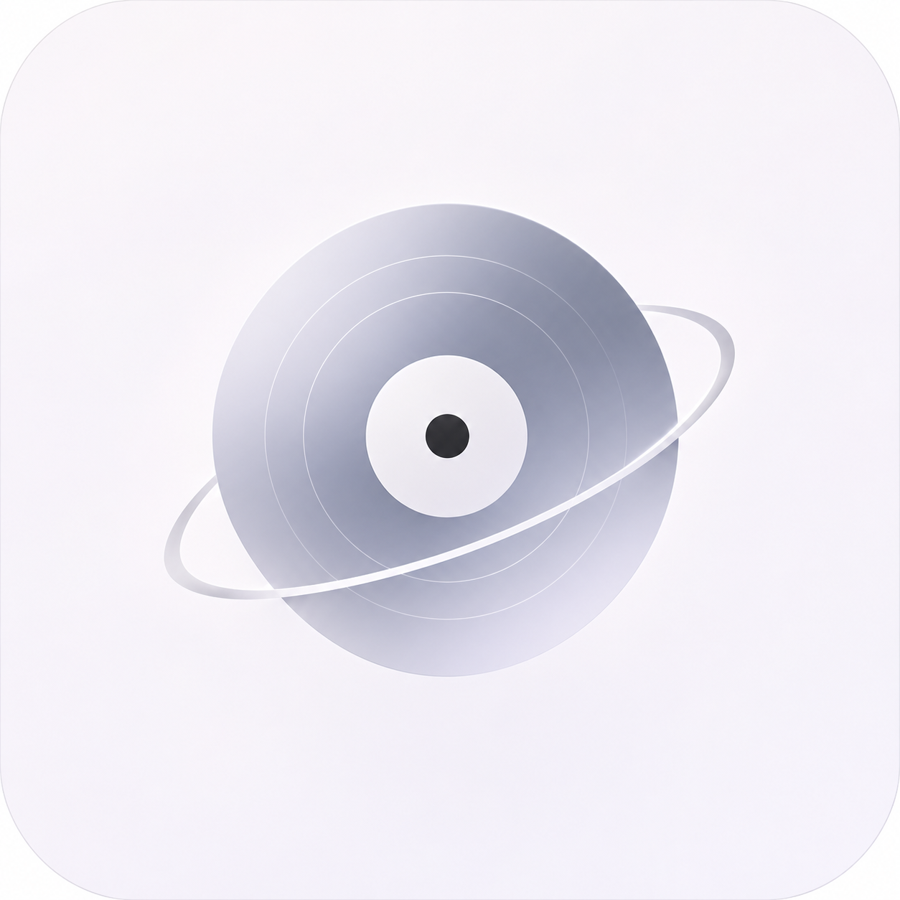

<h1 align="center">听歌</h1>

JUST LISTEN · 用唱片挑选本地音乐

<a href="https://github.com/Frrrrrranz/JustListen/releases/latest/download/JustListen.apk">下载 Android 版</a> · <a href="https://frrrrrranz.github.io/JustListen/">项目网页</a>

---

- 沿弧形唱片队列滑动，停在想听的那一首。
- 唱片停靠后进入播放，支持暂停、继续和拖动进度。
- 扫描设备音乐，或选择文件夹导入本地歌曲。

Android 8.0 及以上 · [GPL-3.0](LICENSE)
